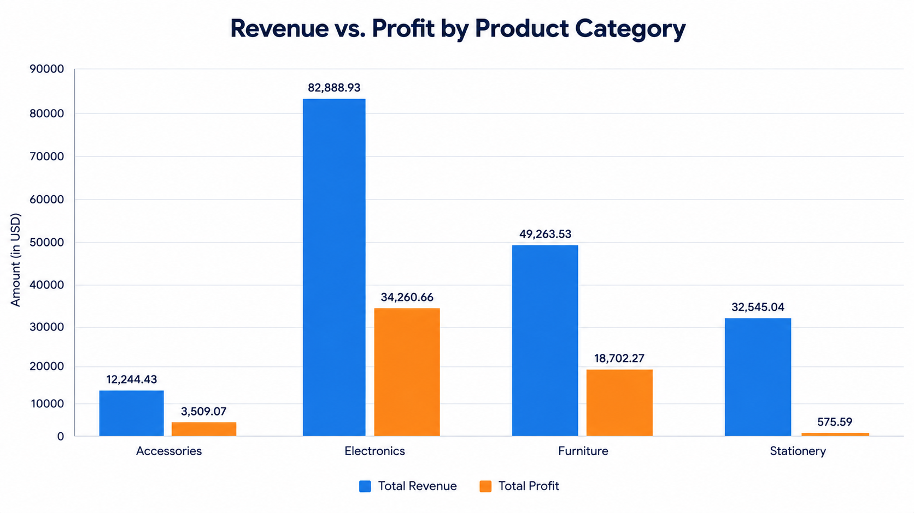

📊 Retail Sales Data Analysis | Google Sheets

A data analytics portfolio project exploring retail revenue, estimated profit, product category performance, and business insights using Google Sheets.

👋 About This Project

This project is part of my journey toward becoming a Data Analyst. I worked with a fictional retail sales dataset to practice data quality checks, KPI calculations, category-level analysis, and data visualization.

The goal is to turn raw sales data into understandable metrics and business insights that can support better decision-making.

🎯 Business Objectives

Measure overall retail sales performance using key performance indicators (KPIs).

Analyze total revenue and estimated profit.

Compare revenue and estimated profit across product categories.

Examine order volume and sales quantity.

Identify categories that may need further investigation.

Present findings through clear charts and documentation.

🛠️ Tools & Skills

Tools

Google Sheets / Spreadsheet formulas

WPS Office for spreadsheet analysis and visualization

GitHub for project documentation and version control

Skills Practiced

Data quality validation

KPI calculation

Spreadsheet formulas and conditional aggregation

Category-level sales analysis

Data visualization

Business insight communication

Project documentation

📁 Dataset Overview

The dataset contains 300 fictional retail orders from 2025.

Column

Description

Order_ID

Unique order identifier

Order_Date

Date of the order

Product

Product name

Category

Product category

Quantity

Units ordered

Unit_Price

Price per unit before discount

Discount_Pct

Discount applied

Region

Sales region

Sales_Channel

Sales channel

Revenue

Revenue after discount

Estimated_Cost

Illustrative estimated cost

Profit

Estimated profit

Data note: This is simulated practice data. Costs and profits are estimates, and the dataset does not represent an actual company or real business performance.

📈 Project KPIs

The initial analysis produced the following results:

KPI

Result

Total Revenue

221,524.05

Total Estimated Profit

57,047.59

Total Orders

300

Average Revenue per Order

738.41

Overall Estimated Profit Margin

25.75%

Profit margin formula:

Estimated Profit Margin = (Total Estimated Profit / Total Revenue) × 100

These figures are expressed in the dataset's monetary units; a currency has not been independently verified.

📊 Visualization: Revenue vs. Profit by Product Category

The chart compares revenue and estimated profit across Accessories, Electronics, Furniture, and Stationery.

Key Findings

Electronics recorded the highest revenue at 82,888.93 and the highest estimated profit at 34,260.66.

Furniture generated 49,263.53 in revenue and 18,702.27 in estimated profit.

Accessories generated 12,243.43 in revenue and 3,509.07 in estimated profit.

Stationery generated 32,545.04 in revenue but only 575.59 in estimated profit.

Business Interpretation

Electronics is the strongest category by revenue and estimated profit in this dataset.

Stationery's estimated profit is low relative to its revenue, so its costs, discounts, and pricing would be worth investigating.

Revenue alone does not tell the full story; estimated profit helps provide a more complete view of category performance.

🧹 Data Quality Checks

The following checks were performed during the initial data preparation:

Confirmed 300 order records.

Checked for missing product names.

Checked for duplicate order IDs.

Confirmed no missing product names or duplicate order IDs in the checked ranges.

💡 Recommendations

Based on the current analysis of the simulated data:

Investigate Stationery profitability: Review estimated costs, discounts, and pricing to understand its low profit margin.

Study Electronics performance: Examine which products contribute most to its high revenue and estimated profit.

Monitor multiple KPIs: Track revenue, estimated profit, profit margin, and order volume together rather than relying on revenue alone.

Extend the analysis: Compare regions and sales channels to identify additional patterns.

These are preliminary recommendations based on the available practice dataset, not verified business conclusions.

📂 Repository Structure

retail-sales-data-analysis/
│
├── README.md
├── Retail Sales Analysis.csv
├── Retail Sales Analysis.xlsx
└── category-analysis.png

Retail Sales Analysis.csv — original dataset.

Retail Sales Analysis.xlsx — spreadsheet workbook containing the data and analysis sheets.

category-analysis.png — revenue versus estimated profit chart.

README.md — project documentation and findings.

If your uploaded filenames differ, update this list to match the exact filenames shown in your GitHub repository.

🚀 Future Improvements

Complete regional performance analysis.

Compare revenue and estimated profit by sales channel.

Add more KPI visualizations.

Build a consolidated sales dashboard.

Document additional findings and business recommendations.

Extend the project with SQL and/or Python analysis.

👨‍💻 About Me

Hi, I'm Mohit Sati, an aspiring Data Analyst working on practical projects to develop my analytical and problem-solving skills.

I'm interested in working with data to identify patterns, understand business performance, and communicate useful insights through clear visualizations.

I'm continuously learning and building projects to strengthen my portfolio and prepare for entry-level Data Analyst opportunities.

🤝 Connect With Me

GitHub: MohitSati7

LinkedIn: Connect with me on LinkedIn

⭐ Thank you for visiting my project! Feedback and suggestions are always welcome.
